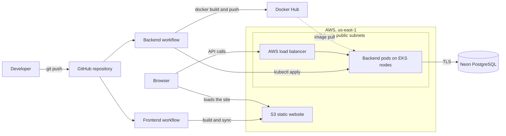

# Student Management: CI/CD on AWS EKS

A three-tier student management application deployed with a fully automated pipeline. The React frontend is served from Amazon S3, the Node.js backend runs on Kubernetes (Amazon EKS), and the data lives in an external managed PostgreSQL database (Neon). All AWS infrastructure is created with Terraform, and every push to GitHub is built, tested and deployed by GitHub Actions without manual steps.

## Table of contents

1. [Architecture](#architecture)
2. [Tech stack](#tech-stack)
3. [Repository structure](#repository-structure)
4. [How the pieces connect](#how-the-pieces-connect)
5. [CI/CD workflows](#cicd-workflows)
6. [Terraform infrastructure](#terraform-infrastructure)
7. [Kubernetes manifests](#kubernetes-manifests)
8. [Configuration and secrets](#configuration-and-secrets)
9. [Run locally](#run-locally)
10. [Deploy from scratch](#deploy-from-scratch)
11. [API reference](#api-reference)
12. [Security notes](#security-notes)
13. [Cost and teardown](#cost-and-teardown)
14. [Problems solved along the way](#problems-solved-along-the-way)
15. [Roadmap](#roadmap)

## Architecture



The frontend and backend are deployed independently. A change to `frontend/` only redeploys the static site, and a change to `backend/` only builds a new image and rolls it out on the cluster.

## Tech stack

| Layer | Technology |
|-------|------------|
| Frontend | React 18, Vite |
| Frontend hosting | Amazon S3 (static website hosting) |
| Backend | Node.js, Express |
| Database | PostgreSQL on Neon (external, managed) |
| Containers | Docker, Docker Hub |
| Orchestration | Amazon EKS (Kubernetes) |
| Infrastructure as code | Terraform (plain resources, no community modules) |
| CI/CD | GitHub Actions |

## Repository structure

```
.
├── .github/
│   └── workflows/
│       ├── frontend.yml        Build the React app and sync it to S3
│       └── backend.yml         Build image, push to Docker Hub, deploy to EKS
├── backend/
│   ├── server.js               Express API and health endpoint
│   ├── db.js                   PostgreSQL pool and table creation
│   ├── Dockerfile
│   ├── .dockerignore
│   └── .env.example
├── frontend/
│   ├── src/                    React components and styles
│   ├── index.html
│   ├── vite.config.js
│   └── .env.example
├── k8s/
│   ├── deployment.yaml         Backend Deployment (2 replicas, probes, limits)
│   └── service.yaml            LoadBalancer Service
├── ekswith-tf/
│   ├── main.tf                 VPC, IAM roles, EKS cluster, node group
│   ├── variables.tf
│   ├── versions.tf
│   └── outputs.tf
└── README.md
```

## How the pieces connect

This is the path a request takes from the browser to the database.

1. **The browser loads the site from S3.** S3 static website hosting serves `index.html` and the built JavaScript over HTTP.
2. **The JavaScript calls the backend directly.** S3 only stores files and runs no code. The browser executes the JavaScript, and that code sends `fetch` requests straight to the backend's public address. The address is not looked up at runtime: Vite replaces `import.meta.env.VITE_API_URL` with the real value during `npm run build`, so it is written into the built files.
3. **The request reaches the AWS load balancer.** The Kubernetes Service of type `LoadBalancer` makes AWS create a load balancer. It listens on port 80 and forwards traffic to the cluster nodes, which route it to a healthy pod on port 5000.
4. **A backend pod handles the request.** Two replicas run behind the Service. The readiness probe calls `/health`, so a pod only receives traffic once it can reach the database.
5. **The pod queries Neon over TLS.** The connection string reaches the pod as the `DATABASE_URL` environment variable, which Kubernetes injects from a Secret.
6. **CORS controls who may call the API.** The backend only accepts requests whose `Origin` header matches the `CORS_ORIGIN` list, which contains the S3 website addresses. The match must be exact: same scheme, same host, and no trailing slash.

Because the frontend is served over plain HTTP and the backend is also plain HTTP, the browser does not block the calls as mixed content. See [Security notes](#security-notes) for the HTTPS discussion.

## CI/CD workflows

Both workflows live in `.github/workflows/` and are filtered by path, so each one only runs when its own code changes.

### Frontend workflow (`frontend.yml`)

Trigger: a push to `main` that changes `frontend/**` or the workflow file, or a manual run.

| Step | What it does |
|------|--------------|
| Checkout | Fetches the repository |
| Setup Node | Installs Node 20 with the npm cache |
| `npm ci` | Installs exact dependency versions from the lockfile |
| `npm run build` | Builds the site; `VITE_API_URL` is injected from a GitHub variable |
| Configure AWS credentials | Logs in with a user that can only write to the bucket |
| `aws s3 sync dist ... --delete` | Uploads changed files and removes files that no longer exist |

Vite adds a content hash to the JavaScript and CSS file names, so every release produces new file names and the sync removes the old ones.

### Backend workflow (`backend.yml`)

Trigger: a push to `main` that changes `backend/**`, the Kubernetes manifests or the workflow file, or a manual run. A concurrency group prevents two deployments from running at once.

**Job 1: Build and push image**

| Step | What it does |
|------|--------------|
| Syntax check | Runs `npm ci` and `node --check` on the source files |
| Docker Buildx and login | Authenticates to Docker Hub with an access token |
| Build and push | Builds the image from `backend/` and pushes it tagged with the commit SHA |

**Job 2: Deploy to EKS** (runs only if the build succeeds)

| Step | What it does |
|------|--------------|
| Configure AWS credentials | Uses a dedicated deploy user |
| `aws eks update-kubeconfig` | Writes the cluster connection details for `kubectl` |
| Create or update the DB secret | Builds the Kubernetes Secret from a GitHub secret using `--dry-run=client -o yaml \| kubectl apply -f -`, which is safe to repeat on every run |
| Point the manifest at the new image | Rewrites the image line in `deployment.yaml` to the new SHA tag (inside the runner only) |
| Apply manifests | `kubectl apply` for the Deployment and the Service |
| Wait for the rollout | `kubectl rollout status` fails the job if the new pods never become ready |

**Why images are tagged with the commit SHA.** Kubernetes only acts when the Deployment spec changes. With a constant tag such as `latest` the spec never changes, so nothing would roll out, and there would be no record of which code is running. A unique tag per commit triggers a rolling update with no downtime, makes every running version traceable to a commit, and allows rollback with `kubectl rollout undo deployment/student-backend`.

## Terraform infrastructure

All infrastructure is defined with plain Terraform resources in `ekswith-tf/`, with no community modules, so every component is visible and explained. The default region is `us-east-1`.

| Resource | Terraform type | Purpose |
|----------|----------------|---------|
| VPC | `aws_vpc` | Network for the cluster, `10.0.0.0/16`, DNS support enabled |
| Internet gateway | `aws_internet_gateway` | Gives the VPC a route to the internet |
| Public subnets (2) | `aws_subnet` | One per availability zone, tagged for public load balancers |
| Route table | `aws_route_table` | Sends `0.0.0.0/0` through the internet gateway |
| Route table associations (2) | `aws_route_table_association` | Attach the route table to both subnets |
| Cluster IAM role | `aws_iam_role` | Lets the EKS control plane manage AWS resources |
| Cluster policy attachment | `aws_iam_role_policy_attachment` | `AmazonEKSClusterPolicy` |
| Node IAM role | `aws_iam_role` | Identity for the worker nodes |
| Node policy attachments (3) | `aws_iam_role_policy_attachment` | `AmazonEKSWorkerNodePolicy`, `AmazonEKS_CNI_Policy`, `AmazonEC2ContainerRegistryReadOnly` |
| EKS cluster | `aws_eks_cluster` | Kubernetes control plane, access managed through EKS access entries |
| Managed node group | `aws_eks_node_group` | Two `t3.medium` worker nodes on Amazon Linux 2023 |
| Pipeline access entry | `aws_eks_access_entry` | Registers the deploy user with the cluster |
| Pipeline access policy | `aws_eks_access_policy_association` | Grants edit rights in the `default` namespace only |

### Design decisions

- **Public subnets and no NAT gateway.** A NAT gateway bills every hour even when idle and would cost more than the worker nodes in a short-lived environment. The nodes sit in public subnets and only accept the traffic Kubernetes allows. A production setup would use private subnets with NAT.
- **Access entries instead of the `aws-auth` ConfigMap.** The cluster uses API authentication mode. The identity that runs `terraform apply` becomes cluster admin automatically, and the pipeline user is added with the `AmazonEKSEditPolicy` limited to the `default` namespace, so it cannot change anything else in the cluster.
- **Separate roles for control plane and nodes.** They are different AWS services with different permissions.
- **Explicit `depends_on` for policy attachments.** The cluster and node group must not be created before their policies are attached, or creation can fail intermittently.
- **Supported Kubernetes version.** The default version is in standard support. Versions in extended support are billed at a much higher hourly rate.

### Variables

| Variable | Default | Description |
|----------|---------|-------------|
| `region` | `us-east-1` | AWS region |
| `cluster_name` | `student-app` | Name of the EKS cluster |
| `kubernetes_version` | `1.36` | Kubernetes version |
| `node_instance_type` | `t3.medium` | Worker node instance type |
| `node_count` | `2` | Number of worker nodes |
| `pipeline_user_arn` | none | IAM user that the deploy pipeline authenticates as |

### Usage

```bash
cd ekswith-tf
terraform init
terraform validate
terraform plan  -var="pipeline_user_arn=arn:aws:iam::ACCOUNT_ID:user/github-actions-backend"
terraform apply -var="pipeline_user_arn=arn:aws:iam::ACCOUNT_ID:user/github-actions-backend"
```

Cluster creation takes about 15 to 20 minutes. Connect to it with:

```bash
aws eks update-kubeconfig --region us-east-1 --name student-app
kubectl get nodes
```

Terraform state (`terraform.tfstate`) is kept locally and is excluded from Git because it can contain sensitive values.

## Kubernetes manifests

**`k8s/deployment.yaml`**

- Two replicas, so one pod can fail without downtime and rolling updates replace pods gradually.
- `DATABASE_URL` is read from the `student-backend-secret` Secret through `secretKeyRef`, never written in the file.
- A readiness probe calls `/health`, which also checks the database, so traffic only reaches pods that are fully working.
- A liveness probe only checks that the port answers. It deliberately does not use `/health`, so a temporary database problem does not cause healthy pods to be restarted in a loop.
- CPU and memory requests and limits stop one pod from exhausting a node.

**`k8s/service.yaml`**

- Type `LoadBalancer` on port 80, forwarding to container port 5000. AWS provisions the load balancer, and its hostname appears in the `EXTERNAL-IP` column of `kubectl get svc`.

## Configuration and secrets

The repository contains no credentials. Configuration reaches each component in a different way.

| Value | Where it lives | How it is used |
|-------|----------------|----------------|
| Database URL (local) | `backend/.env` (git-ignored) | Read by `dotenv` when running locally |
| Database URL (cluster) | GitHub secret `DATABASE_URL`, then a Kubernetes Secret | The pipeline creates the Secret; Kubernetes injects it as an environment variable |
| Backend API address | GitHub variable `VITE_API_URL` | Written into the JavaScript at build time |
| CORS allowed origins | `CORS_ORIGIN` in `deployment.yaml` | Checked by the backend on every request |

GitHub Actions secrets and variables:

| Name | Type | Used by |
|------|------|---------|
| `AWS_ACCESS_KEY_ID`, `AWS_SECRET_ACCESS_KEY` | Secrets | Frontend workflow (S3 write access only) |
| `S3_BUCKET` | Secret | Frontend workflow |
| `VITE_API_URL` | Variable | Frontend build |
| `DOCKERHUB_USERNAME`, `DOCKERHUB_TOKEN` | Secrets | Backend workflow (image push) |
| `EKS_AWS_ACCESS_KEY_ID`, `EKS_AWS_SECRET_ACCESS_KEY` | Secrets | Backend workflow (cluster deploy user) |
| `DATABASE_URL` | Secret | Backend workflow (creates the Kubernetes Secret) |

The two AWS users are separate and least-privilege. The frontend user can only list, write and delete objects in one bucket. The deploy user can only call `eks:DescribeCluster` and has edit rights in one namespace of the cluster.

## Run locally

Requirements: Node.js 20, a PostgreSQL connection string (for example from a free Neon project).

**Backend**

```bash
cd backend
cp .env.example .env        # set DATABASE_URL in .env
npm install
npm start                   # http://localhost:5000
```

Check `http://localhost:5000/health`, which should return `{"status":"ok","db":"connected"}`. The `students` table is created automatically on startup.

**Frontend**

```bash
cd frontend
cp .env.example .env        # VITE_API_URL=http://localhost:5000
npm install
npm run dev                 # http://localhost:5173
```

**Backend in Docker**

```bash
cd backend
docker build -t student-backend:local .
docker run -p 5000:5000 --env-file .env student-backend:local
```

The `.dockerignore` file keeps `.env` out of the image, so secrets are supplied at run time and never baked in.

## Deploy from scratch

1. Create a Neon project and copy the connection string.
2. Create an S3 bucket with static website hosting enabled, public access unblocked, and a bucket policy that allows `s3:GetObject`.
3. Create an IAM user for the frontend pipeline (write access to the bucket only) and one for the backend pipeline (`eks:DescribeCluster` only).
4. Run `terraform apply` in `ekswith-tf/` to create the VPC, cluster, node group and pipeline access entry.
5. Add the GitHub secrets and the `VITE_API_URL` variable listed above.
6. Push to `main`. The backend workflow builds the image, creates the Secret and deploys. Read the load balancer address with `kubectl get svc student-backend`.
7. Set `VITE_API_URL` to `http://<load-balancer-hostname>` and set `CORS_ORIGIN` in `deployment.yaml` to the S3 website address.
8. Push a change under `frontend/` so the site is rebuilt with the new API address.

## API reference

| Method | Path | Description |
|--------|------|-------------|
| GET | `/health` | Health check, verifies database connectivity |
| GET | `/api/students` | List all students |
| POST | `/api/students` | Create a student (`name`, `email`, `course`, optional `age`) |
| PUT | `/api/students/:id` | Update a student |
| DELETE | `/api/students/:id` | Delete a student |


## Security notes

- No secrets are committed. `.env`, Terraform state and the real Secret manifest are git-ignored.
- Pipeline credentials are scoped to the minimum each workflow needs. A possible next step is replacing long-lived access keys with GitHub OIDC and an assumable IAM role.
- Kubernetes Secrets are only base64-encoded, not encrypted. A production setup would use AWS Secrets Manager with the External Secrets operator.
- Traffic between the browser and the backend is unencrypted HTTP, which is acceptable for a demo only. A production setup would put CloudFront and an HTTPS certificate in front of both the site and the API.
- Worker nodes run in public subnets to avoid NAT costs. A production setup would use private subnets.


